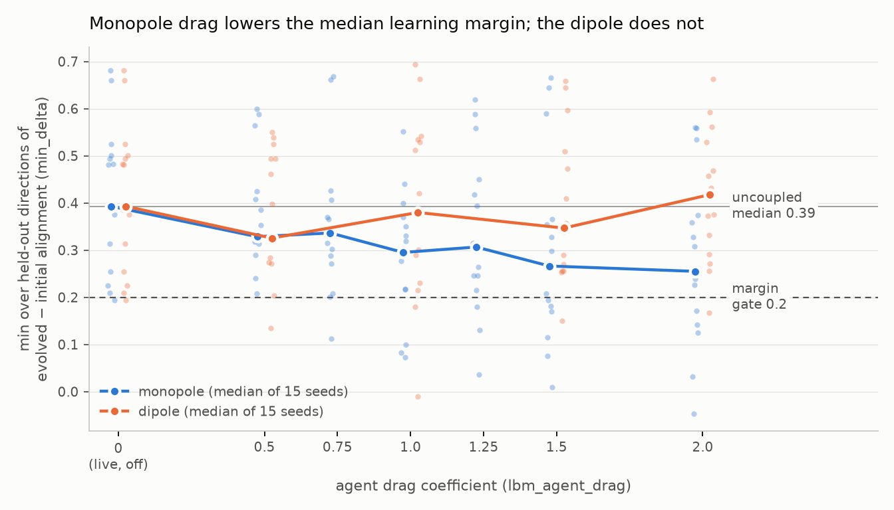

# Drag sweep: where does the monopole-coupling penalty begin?

Status: **exploratory pilot, 15 seeds per condition. The monopole penalty is a resolved
dose-response trend (13 of 15 seeds have a negative slope against drag, p = 0.0017), but no
single drag value is resolved after multiplicity correction, and the data cannot locate a
sharp onset. The dipole shows no effect at any drag. A later mechanism study
(`exp/lbm-live-mechanism`) found that the monopole drag-2.0 loss is mostly inflation of the
baseline by each agent's own wake, so this trend is probably the same effect rather than a
cost to learning; whether it is was tested on `exp/lbm-live-sweep-rescored`
(`drag_sweep_rescored/`). Not a claim.**

Parent study: `../README.md` (drag 0.5 unresolved, drag 2.0 resolved worse for the monopole,
dipole unaffected). Same protocol, carrier and seeds (0-14); this adds monopole drag
0.75, 1.0, 1.25, 1.5 and dipole drag 1.0, 1.5. The B (live, drag 0), C, D, E and F rows are
reused from the parent folder, not re-run.

## Reproducibility check

Re-running monopole drag 2.0, seeds 0-2, reproduces the parent's JSON exactly: maximum
difference in `min_delta` 0.0, in `min_reversed` 0.0, and identical pass flags. The
reused conditions are therefore comparable with the new runs.

## Results (min_delta against B, the live fluid with coupling off; B equals the legacy
baseline seed for seed)

| Condition | Pass | Median min_delta | Failing seeds (min_delta) | Mean change vs B | Worse / better | Paired Wilcoxon p | Holm p (6 monopole drags) |
|---|---|---|---|---|---|---|---|
| B, drag 0 | 14/15 | 0.393 | 1 (0.193) | n/a | n/a | n/a | n/a |
| Monopole 0.5 | 15/15 | 0.328 | none | -0.034 | 10 / 5 | 0.489 | 0.489 |
| Monopole 0.75 | 14/15 | 0.336 | 4 (0.113) | -0.060 | 11 / 4 | 0.055 | 0.166 |
| Monopole 1.0 | 12/15 | 0.295 | 3 (0.083), 4 (0.100), 8 (0.073) | -0.124 | 11 / 4 | 0.010 | 0.062 |
| Monopole 1.25 | 12/15 | 0.307 | 4 (0.036), 7 (0.180), 9 (0.131) | -0.080 | 12 / 3 | 0.064 | 0.166 |
| Monopole 1.5 | 9/15 | 0.266 | 1 (0.182), 4 (0.010), 6 (0.115), 7 (0.171), 8 (0.076), 14 (0.194) | -0.114 | 13 / 2 | 0.010 | 0.062 |
| Monopole 2.0 | 10/15 | 0.255 | 4 (-0.047), 6 (0.032), 7 (0.171), 9 (0.142), 14 (0.125) | -0.134 | 13 / 2 | 0.0125 | 0.062 |
| Dipole 0.5 | 14/15 | 0.325 | 9 (0.134) | -0.039 | 9 / 6 | 0.359 | n/a |
| Dipole 1.0 | 13/15 | 0.380 | 6 (-0.010), 8 (0.179) | -0.021 | 5 / 10 | 0.679 | n/a |
| Dipole 1.5 | 14/15 | 0.347 | 6 (0.150) | -0.024 | 8 / 7 | 0.639 | n/a |
| Dipole 2.0 | 14/15 | 0.418 | 8 (0.168) | +0.001 | 7 / 8 | 0.978 | n/a |

Per-seed `min_reversed` is unaffected: condition means range 0.47 to 0.55 (B 0.53), so the
failures are margin failures, not a switch to a fixed action.

## Dose-response

- **Primary test (one test, no correction needed):** for each seed, the least-squares
  slope of `min_delta` against drag across the seven monopole drags (0, 0.5, 0.75, 1.0,
  1.25, 1.5, 2.0). Mean slope **-0.068 per unit drag**; 13 of 15 seeds negative; one-sided
  Wilcoxon on the slopes **p = 0.0017**. Seeds are shared across drags, so a per-seed
  slope is the paired analysis.
- Secondary: pooled Spearman of `min_delta` against drag, rho = -0.27, p = 0.0056. This
  treats the 105 values as independent although each seed appears at seven drags, so the
  p-value is overstated; reported for completeness only.
- **Per-drag tests against B:** raw p is below 0.05 at 1.0, 1.5 and 2.0 (0.010, 0.010,
  0.0125) and near it at 0.75 and 1.25 (0.055, 0.064). With **Holm correction over the six
  monopole drags none is below 0.05** (0.062 at 1.0, 1.5, 2.0). The per-drag
  results are suggestive; the trend is the resolved statement.
- **Bootstrap 95% CI of the paired mean change** (5000 resamples of seeds, unadjusted):
  0.5 [-0.091, 0.024] includes zero; 0.75 [-0.116, -0.004]; 1.0 [-0.204, -0.039]; 1.25
  [-0.145, -0.016]; 1.5 [-0.192, -0.035]; 2.0 [-0.211, -0.057] all exclude zero.

### Onset

The data do not support a sharp onset (a hinge fit gives no improvement over a line). The change is -0.034 at 0.5 and its interval spans
zero, which is what a line through the origin predicts (-0.068 x 0.5 = -0.034). A linear
fit to the seven mean changes has a smaller squared error (0.00267) than a hinge
(threshold) fit (0.00320), and the best hinge sits at the lower edge of the grid searched
(0.25), i.e. it degenerates to the linear model. This comparison counts the zero-drag point
(zero change by construction) among the seven; with only the six coupled drags the line and
the best hinge fit equally well (SSE 0.00247 each, hinge onset about 0.35-0.45), so the
evidence against a threshold rests on that anchor and is weak. The response is consistent with
**gradual and roughly proportional to drag, from the smallest value tested**. The
practical statement: effects are unresolved at 0.5 or below, hinted at 0.75, and
distinguishable from zero without correction from 1.0 up. The apparent non-monotonic steps
(1.0 worse than 1.25) are within seed noise; seed 4 fails at five of the six monopole
drags and drives some of the pass-count variation.

## Monopole against dipole at matched drag (paired, Wilcoxon on min_delta)

| Drag | Mean (dipole - monopole) | p | Holm p (4 comparisons) |
|---|---|---|---|
| 0.5 | -0.005 | 0.890 | 0.890 |
| 1.0 | +0.103 | 0.041 | 0.083 |
| 1.5 | +0.090 | 0.0009 | 0.0036 |
| 2.0 | +0.135 | 0.0034 | 0.010 |

From 1.5 up the dipole is resolved better than the monopole after correction; at 1.0 it
is suggestive (uncorrected 0.041); at 0.5 there is no difference. The dipole curve is flat
within noise: no dipole drag differs from B (p = 0.36 to 0.98).

## Caveats

- Exploratory: seven drag values, two coupling types and many tests were examined; only
  the per-seed slope was specified as the primary test. Treat per-drag p-values as
  descriptive.
- 15 seeds, one 14x14 periodic carrier with a mean-flow controller, and an uncalibrated
  drag coefficient. The monopole is the unphysical model (thrust treated as an external
  push), so this measures sensitivity to that model, not behaviour of real swimmers.
- Dipole length is quantised to even cell separations (see parent), so the dipole is not
  smoothly tunable and its strength at a given drag is not directly comparable to the
  monopole's.
- Training and evaluation both run coupled; no train-uncoupled, test-coupled condition.
- The mechanism is not tested here. The noisier-flow-estimate idea was later not supported
  (`exp/lbm-live-estimate`), and self-contamination of the baseline was found to be the main
  driver at drag 2.0 (`exp/lbm-live-mechanism`).

## Files

Every table and p-value above was recomputed from the per-seed JSONs by an independent script
(`scripts/audit_lbm_results.py` on `exp/lbm-live-sweep-rescored`) and reproduces; the bootstrap
intervals reproduce at the printed precision with a fixed resampling seed.

Per-condition per-seed JSONs `seeds0-14_<mode>_<drag>.json`, the reproducibility JSON, the
chart, `analysis.py` (prints every statistic above; needs numpy and scipy) and
`summary.json` (its output).

Reproduce one condition (from the worktree, `PYTHONPATH=src JAX_PLATFORMS=cpu`):
`python scripts/run_embodied_law_study.py --seeds 0 1 2 3 4 --generations 8 --population 16
--steps-per-generation 8 --size 14 --eval-steps 12 --displacement-reward 5.0
--unit-flow-features --flow-head --fitness-mode min_alignment --fitness-steps 6
--rank-replacement --immigrant-fraction 0.25 --law-carrier live --lbm-drag 1.0
--lbm-coupling monopole`. Run seeds as separate processes if you want speed; each seed is
independent. If the native library is absent, run `make -C native` once first; concurrent
first runs race to build it.
