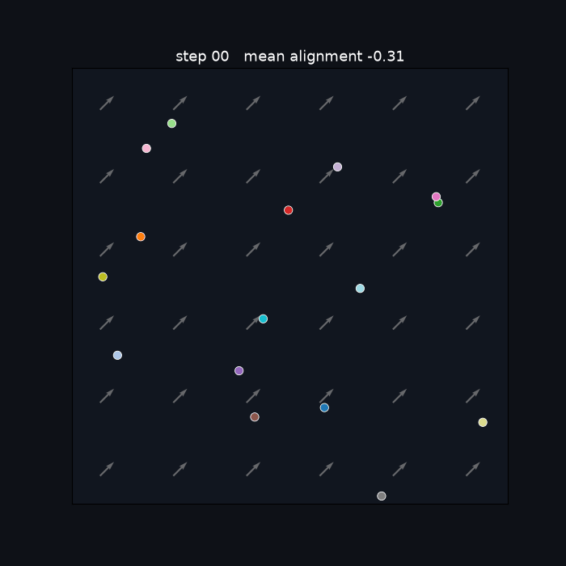
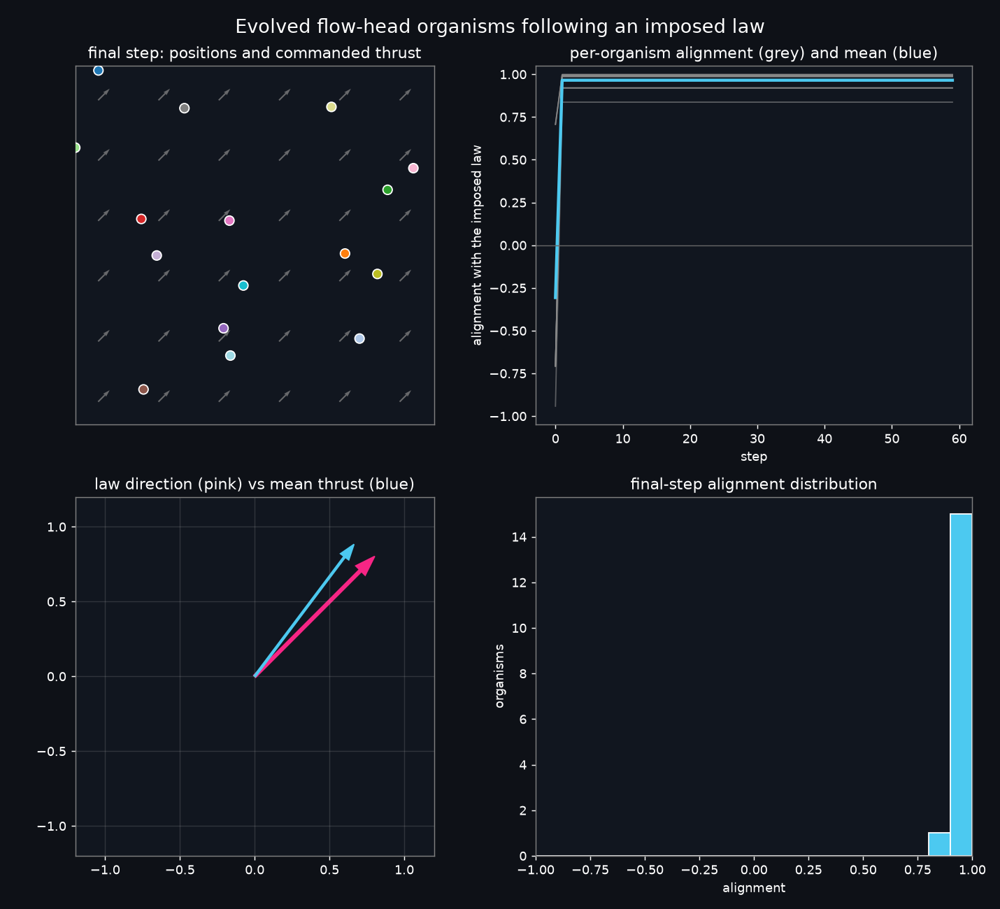

# Flow-head organisms: visualization

Evolved flow-head organisms following an imposed diagonal law. Seed 0 of the
accepted no-immigrant configuration, 20 generations, rolled out on a held-out
diagonal after training.



[Watch the MP4, 3 seconds, 700x700](flow_head.mp4)



## What you are looking at

- Grey arrows: the imposed law, a uniform diagonal flow.
- Coloured dots: the 16 evolved organisms, each with a trail.
- Short coloured arrows: each organism's commanded thrust.
- Title: step number and mean alignment with the law.

## Result

- Mean alignment starts at **-0.31** on step 0.
- It jumps to **+0.97** within one step and stays there.
- The final-step histogram is concentrated near **+0.9**.
- The mean thrust points along the law direction.

The organisms stop fighting the flow and ride it, almost immediately.

## Configuration

The `no_immigrants` cell of the ablation, which is the accepted five-seed claim:

- Flow-only head, unit-flow feature, proprioception on.
- Min-alignment fitness, 6 frozen steps per direction.
- Rank replacement with `elite_fraction = 0.5`, no immigrants.
- Seed 0, 20 generations, 16 agents, 8 steps per generation, 14x14 world.
- Rollout on the held-out diagonal with 60 steps.

## Reproduce

```bash
JAX_PLATFORMS=cpu python scripts/visualize_flow_head.py \
  --seed 0 --generations 20 --steps 60 --fps 20 --format both \
  --direction diagonal --out-dir docs/results/flow_head_visualization
```

Change `--direction` to `anti_diagonal`, `east`, or `north` to see the same policy
follow a different law. Change `--seed` to render another run.

## Boundary

This is a visualization of the bounded pilot. It is not new evidence beyond
`docs/results/embodied_law_no_immigrant_confirmation/`.
