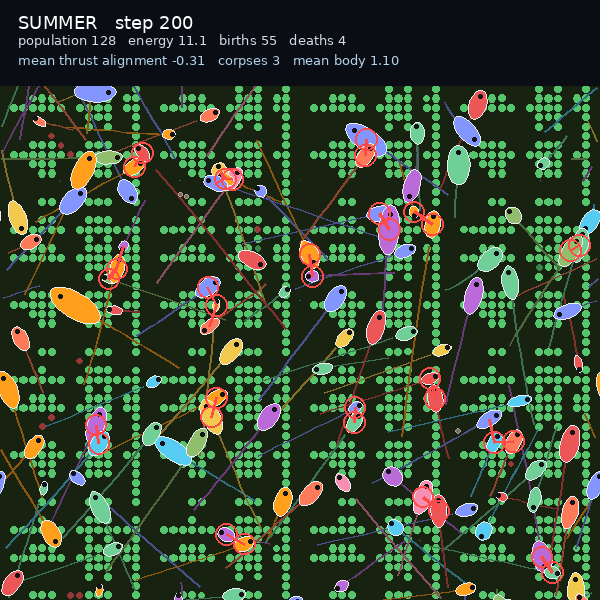

# Vivarium attacks: visible predation

Predation is now visible: a red strike line from the attacker and a red ring on
the prey.



[Watch the 10 second clip](attacks.mp4)

## What changed

- `EmbodiedPopulationState.last_attack` and `last_attack_target` record the
  per-step predation events.
- `apply_embodied_actions` fills them when predation fires.
- The renderer draws a red line from each attacker to its prey and a red ring on
  the prey. Wrapped strikes are skipped, so no line crosses the world seam.

## Result

- 200 steps: population 126 to 128, 55 births, 4 deaths, mean energy 11.1
- Red strike lines and prey rings are visible throughout the clip and the live view

## Watch it live

```bash
JAX_PLATFORMS=cpu venv/bin/python scripts/serve_vivarium.py
```

http://127.0.0.1:8765

## Tests

`tests/test_embodied_predation.py` also checks that the attack event and target
are recorded.

## Next

Prey escape behavior would turn the strike into a chase. After that, a
population-balance sweep over predation rates.
