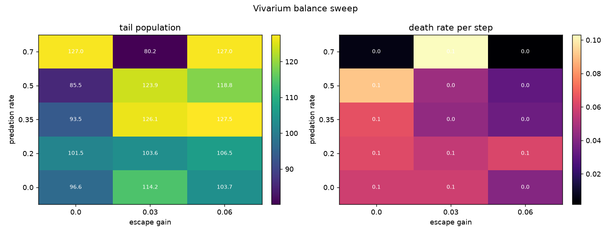

# Vivarium balance sweep

Status: **the current world setting is in a stable, active band.** The sweep
validates the product defaults and maps where the world collapses or goes quiet.



## Design

- Predation rate: 0.0, 0.2, 0.35, 0.5, 0.7.
- Escape gain: 0.0, 0.03, 0.06.
- 2 seeds per cell, 800 steps, 128 organisms, 64x64 world.
- Readouts: tail population, death rate per step, tail energy, tail body radius.

## Result

| Predation | Escape | Population | Death rate | Energy | Body |
| --- | --- | --- | --- | --- | --- |
| 0.35 | 0.03 | 126 | 0.044 | 10.6 | 1.18 |
| 0.35 | 0.06 | 128 | 0.034 | 10.4 | 1.15 |
| 0.50 | 0.03 | 124 | 0.046 | 10.3 | 1.18 |
| 0.50 | 0.06 | 119 | 0.032 | 7.3 | 1.19 |
| 0.50 | 0.00 | 86 | 0.091 | 7.3 | 1.13 |
| 0.70 | 0.03 | 80 | 0.103 | 8.4 | 1.10 |
| 0.70 | 0.00 | 127 | 0.006 | 30.7 | 1.25 |
| 0.70 | 0.06 | 127 | 0.002 | 26.7 | 1.05 |

The full table is in `summary.json`.

## Reading

- The stable, active band is predation **0.35 to 0.50** with escape **0.03 to
  0.06**. Population stays near the cap, deaths keep happening, and energy stays
  in the 7 to 11 range.
- High predation with no escape collapses the population: 0.50/0.00 is 86,
  0.70/0.03 is 80.
- High predation with high escape can go quiet: the attack gate rarely lands, the
  death rate drops to 0.002, and energy piles up.
- The current product setting, **0.35/0.03**, is in the stable active band.

## Recommendation

Keep **0.35/0.03** for an active food web. Use **0.35/0.06** if you want a calmer,
fuller world. Avoid the top-right and top-left corners.

## Reproduce

```bash
JAX_PLATFORMS=cpu python scripts/run_vivarium_sweep.py \
  --seeds 0 1 --steps 800 --out docs/results/vivarium_balance
```

## Tests

`tests/test_vivarium_sweep.py`: config carries the balance parameters, a cell runs,
and the aggregate averages seeds.

## Live

http://127.0.0.1:8765
