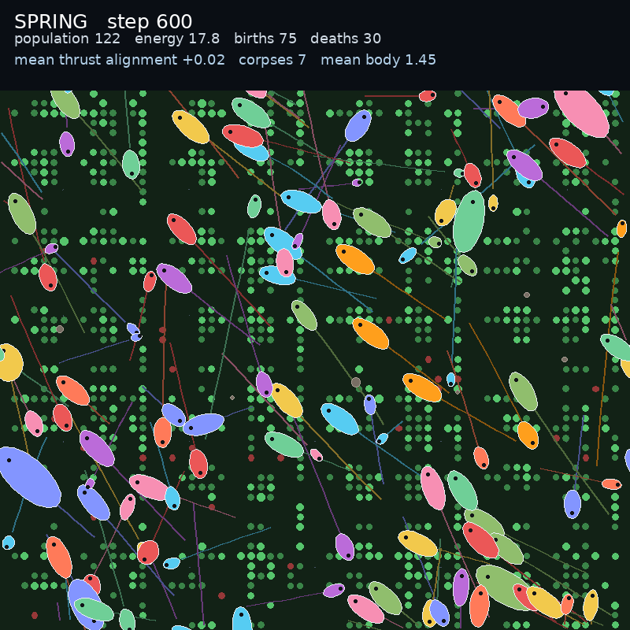

# Vivarium bodies: creatures with shape

The second vivarium milestone. Plain dots become oriented bodies with inherited
body genes.



[Watch the 30 second video](vivarium.mp4)

## What changed

- **Body genes.** Each creature carries `body_radius` and `body_aspect`. Both
  inherit and mutate with the rest of the genome.
- **A real trade-off.** A larger body eats more from a food cell, but pays more
  basal and movement cost. The population can evolve a size.
- **Oriented bodies.** The renderer draws an ellipse stretched along the heading,
  with a dark eye at the front. Size and aspect come from the genes.
- **Morphology is opt-in.** `EmbodiedConfig.body_morphology` is off by default, so
  the D1 research runs keep their exact dynamics.
- **A reproduction bug fixed.** Reproduction assumed genome values were 2D or 3D.
  One-dimensional body genes now inherit correctly.

## Result

- Population 122 to 128, final 122
- 75 births, 30 deaths, 7 corpses
- Mean body radius rose from about 1.1 to 1.45, so larger bodies were favoured in
  this food-rich run
- 30 seconds, 800x800, 600 frames, seed 0

## Honest scope

This is still not Bibites parity. The bodies are simple ellipses. There is no
segmentation, no limbs, no predation, and no live viewer yet.

## Reproduce

```bash
JAX_PLATFORMS=cpu python scripts/run_vivarium.py \
  --steps 600 --warmup 300 --size 800 --population 128 --world 64 \
  --out outputs/vivarium/bodies.mp4 --poster outputs/vivarium/bodies_poster.png
```

Tests: `tests/test_embodied_bodies.py` (genes off by default and on when enabled,
larger body gains more energy from food) and `tests/test_vivarium.py`.

## Next

A live viewer, then the research question embedded as a law-present versus
law-absent condition.
