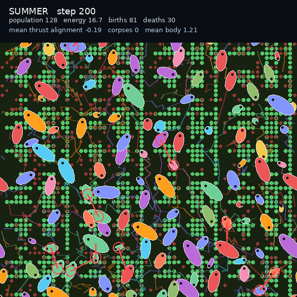

# Vivarium chase: prey escape behavior

Prey now flee from a close neighbour, so the red strike becomes a chase.



[Watch the 10 second clip](chase.mp4)

## What changed

- `EmbodiedConfig.escape_gain` and `escape_radius` (default 0, off).
- Each step, an organism with a neighbour inside the radius moves away from it,
  scaled by the gain. The product world uses gain `0.03`, radius `0.06`.
- The escape is applied before hazard and terraform, after the attack, so the
  strike lands and the prey then bolts.
- The D1 research runs are unchanged; the defaults are off.

## Result

- 200 steps: population 126 to 128, 81 births, 30 deaths, mean energy 16.7,
  mean body 1.21
- More deaths than the no-chase ecosystem, and the red strikes now have visible
  follow-up movement

## Watch it live

```bash
JAX_PLATFORMS=cpu venv/bin/python scripts/serve_vivarium.py
```

http://127.0.0.1:8765

## Tests

`tests/test_embodied_predation.py` now includes the escape reflex: two close
neighbours move apart.

## Next

A population-balance sweep over predation and escape rates, or a visual attack
cooldown so strikes are easier to read.
