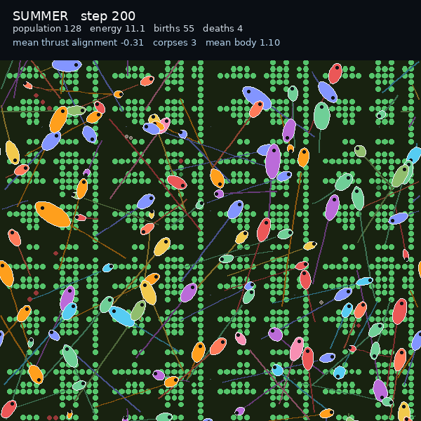

# Vivarium ecosystem: energy balance and predation

The first world-balance pass. The long-run giant is gone, and organisms can now
feed on each other.



[Watch the 10 second clip](ecosystem.mp4)

## What changed

- **Energy cap.** `EmbodiedConfig.max_energy` (default 0, off) stops runaway
  energy. The vivarium uses `80`.
- **Predation.** `EmbodiedConfig.predation_rate` and `predation_radius` (default 0,
  off). An organism that presses its attack gate drains a fraction of the nearest
  neighbour's energy inside the radius. The vivarium uses rate `0.35`, radius
  `0.04`.
- The live viewer and the video runner both enable the new mechanics.
- The D1 research runs are unchanged: both features default to off.

## Result

- 200 steps, 600x600, 20 fps
- Population 126 to 128, final 128
- 55 births, 4 deaths, 3 corpses
- Mean energy 11.1, mean body 1.10

The population stays healthy and the energy stays bounded.

## Watch it live

```bash
JAX_PLATFORMS=cpu venv/bin/python scripts/serve_vivarium.py
```

Then open http://127.0.0.1:8765.

## Reproduce the clip

```bash
JAX_PLATFORMS=cpu python scripts/run_vivarium.py \
  --steps 200 --warmup 200 --size 600 --population 128 --world 64 \
  --out outputs/vivarium/ecosystem.mp4 --poster outputs/vivarium/ecosystem_poster.png
```

## Tests

`tests/test_embodied_predation.py`: the energy cap limits a rich organism, and an
attacker drains a nearby target.

## Next

Predation is currently a simple energy transfer. The next world step could be a
visible attack animation, prey escape behavior, or a population-balance sweep.
