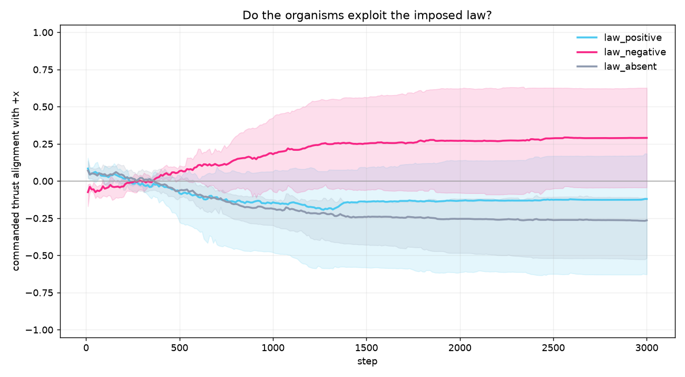

# Vivarium law experiment: do the organisms exploit an imposed law?

Status: **1/3 seeds pass. The population evolves a fixed direction bias, not a
law-following response.**



## Design

The research question is now inside the living world:

- A uniform law (flow) is present in two opposite directions: `law_positive`
  (toward +x) and `law_negative` (toward -x).
- `law_absent` is the same world with zero flow.
- Everything else is matched per seed: food, seasons, population, bodies,
  genomes, and random seed.
- The law is only physically coupled. `flow_alignment_reward = 0` and
  `displacement_reward = 0`, so there is no direct reward for aligning. The
  organisms must exploit the law for survival.
- The law is hidden from the observation. The organisms can infer it only from
  their own previous velocity and thrust.
- The readout is the commanded thrust alignment, scored against each condition's
  own law. The absent control is scored against +x.

Budget: 3 seeds, 3000 steps, 128 organisms, 64x64 world, 150 steps per season,
body morphology on, energy-only selection.

Gate: per seed, both law directions must beat the absent control by `0.2`. A fixed
direction bias cannot pass, because it fails one of the two directions.

## Results

| Seed | Law +x | Law -x | Absent | +x minus absent | -x minus absent | Passed |
| --- | --- | --- | --- | --- | --- | --- |
| 0 | -0.626 | +0.625 | -0.518 | -0.108 | +1.143 | no |
| 1 | +0.164 | -0.054 | -0.109 | +0.273 | +0.055 | no |
| 2 | +0.081 | +0.286 | -0.159 | +0.240 | +0.445 | **yes** |

**1/3 seeds pass.**

Mean across seeds: law +x `-0.127`, law -x `+0.286`, absent `-0.262`.

## Interpretation: a fixed bias, not law-following

The mean absent alignment is `-0.262`, so the population drifts toward -x even
with no law. The -x law looks positive (`+0.286`) because it reinforces that bias.
The +x law stays negative (`-0.127`), so the population does not turn to follow it.
That is the signature of a fixed direction bias, not a law-following response.

Seed 2 is the one case where both directions beat the absent control. One seed in
three is not a consistent effect.

This matches the earlier D1 history. The 5/5 D1 claim needed three mechanisms that
this natural world does not use: a four-parameter flow head, min-alignment fitness,
and rank replacement. With a GRU and energy-only selection, the law is not
consistently exploited.

## Claim boundary

This is a bounded negative/exploratory result. It does not overturn the D1 5/5
bounded claim, which used the controlled setup. It says the effect does not appear
under natural energy-only selection in the vivarium as built.

## Next

Add the D1 mechanisms as an experimental condition inside the vivarium: flow head,
min-alignment fitness, and rank replacement. Compare that condition with the
natural world. If the mechanisms are what matter, the law-following behavior should
appear there and not in the natural world.

## Reproduce

```bash
JAX_PLATFORMS=cpu python scripts/run_vivarium_law.py \
  --seeds 0 1 2 --steps 3000 --population 128 --world 64 \
  --record-every 10 --out docs/results/vivarium_law
```

The live viewer is separate: `scripts/serve_vivarium.py`, then
http://127.0.0.1:8765.
