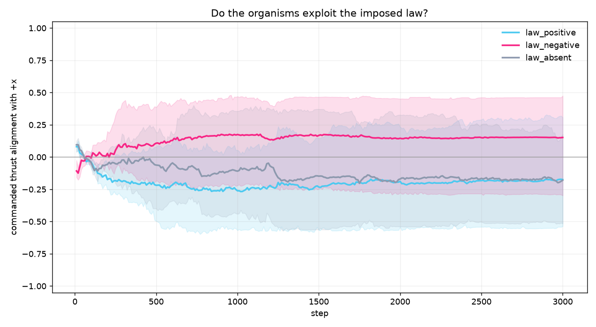

# Vivarium law comparison: natural world vs D1 mechanisms

Status: **both arms pass 1/3 seeds. The D1 mechanisms do not transfer to the
living world as tested. Both arms show a fixed direction bias.**



## Arms

Both arms run the same world, seeds, budget, law conditions, and gate.

- **Natural**: GRU controller, energy-only selection. Results in
  `docs/results/vivarium_law/`.
- **D1 mechanisms**: linear controller, unit-flow feature, min-alignment fitness,
  rank replacement. This arm can eat, unlike the pure flow head.

Why the linear controller, not the flow head: the flow head has zero gates, so it
cannot eat. The first attempt at this arm used the flow head and the population
starved to zero. The linear controller keeps the gates and adds the D1 fitness and
selection mechanisms. It is effectively the `no_flow_head` ablation from the
controlled study, which already failed.

## Results

### Natural arm

| Seed | Law +x | Law -x | Absent | +x minus absent | -x minus absent | Passed |
| --- | --- | --- | --- | --- | --- | --- |
| 0 | -0.626 | +0.625 | -0.518 | -0.108 | +1.143 | no |
| 1 | +0.164 | -0.054 | -0.109 | +0.273 | +0.055 | no |
| 2 | +0.081 | +0.286 | -0.159 | +0.240 | +0.445 | **yes** |

1/3 seeds pass.

### D1 mechanisms arm

| Seed | Law +x | Law -x | Absent | +x minus absent | -x minus absent | Passed |
| --- | --- | --- | --- | --- | --- | --- |
| 0 | -0.294 | +0.280 | -0.512 | +0.218 | +0.792 | **yes** |
| 1 | +0.285 | -0.288 | +0.233 | +0.052 | -0.521 | no |
| 2 | -0.548 | +0.460 | -0.232 | -0.316 | +0.692 | no |

1/3 seeds pass, a different seed than the natural arm.

## What the pattern says

Both arms settle into a fixed direction bias. The passing seed is the one where
the absent bias happens to point along one law, so that law looks positive. In the
D1 arm seed 0, the +x law still ends at `-0.294`: it passes the relative gate by
improving on the absent baseline, but it is not positively aligned with its law.

So the D1 mechanisms do not produce a law-following response in the vivarium. The
controlled D1 5/5 claim is a special setup: flow-only movement head, displacement
reward, and no requirement to eat. It does not transfer to the living world as
built.

## Honest reading

- The living-world law effect is not robust.
- The relative gate can pass a still-negative alignment. The absolute alignment is
  the stronger read, and it is mostly near zero or negative.
- The missing piece is the flow-only head, but it needs an eat gate to survive in
  the vivarium.

## Next design

Give the flow head a constant eat gate. Keep the four-parameter movement head and
let the organism eat automatically when it is on food. Then the flow head can
survive, and the min-alignment fitness and rank replacement can act on a
low-dimensional movement policy. That is the clean test of whether the D1 mechanism
transfers.

## Reproduce

```bash
# Natural arm (already merged)
JAX_PLATFORMS=cpu python scripts/run_vivarium_law.py \
  --arm natural --seeds 0 1 2 --steps 3000 --population 128 --world 64 \
  --out docs/results/vivarium_law

# D1 mechanisms arm
JAX_PLATFORMS=cpu python scripts/run_vivarium_law.py \
  --arm d1 --seeds 0 1 2 --steps 3000 --population 128 --world 64 \
  --out docs/results/vivarium_law_d1
```
