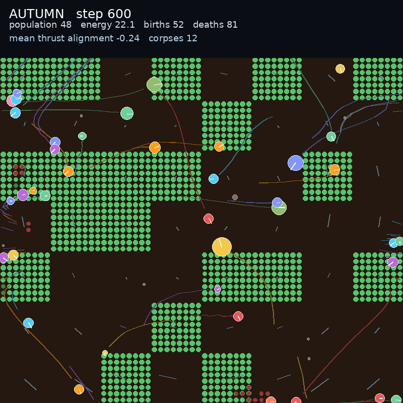

# Vivarium v0: a first living world

This is the first step toward the world you actually wanted: a Bibites-like
ecosystem first, with the research question layered on top later.



[Watch the 30 second video](vivarium.mp4)

## What is alive in it

- **Food patches.** Resources grow in fertile patches, not everywhere.
- **Seasons.** Spring, summer, autumn, and winter change food regrowth.
- **Corpses.** Dead organisms leave a corpse. It decays and returns nutrients to
  the local food patch.
- **Births and deaths.** The population lives and dies. The HUD counts both.
- **Lineages.** Each lineage has a colour. Creatures leave trails.
- **An imposed flow.** The grey streaks are an environmental law the organisms
  experience.
- **A HUD.** Season, step, population, energy, births, deaths, alignment, corpses.

## What this is not yet

This is **v0**, not Bibites parity. It still needs:

- Bodies and morphology, not just circles
- Smaller, more organic food patches
- A live interactive viewer, not only a rendered video
- Ecosystem balance and a longer food web
- A clean split between the world and the research experiment

## The research question, placed correctly

The flow field is already in the world. The next package separates the world from
the experiment: run the same vivarium with the law present and absent, and measure
whether the organisms discover and exploit it. The world stays the product. The
experiment is a condition inside it.

## Current result

The render is 30 seconds, 600 steps, 800x800, 20 fps. Starting population 128,
population range 45 to 64, 54 births and 86 deaths during the run, up to 12
corpses on the ground. Seed 0.

## Reproduce

```bash
JAX_PLATFORMS=cpu python scripts/run_vivarium.py \
  --steps 600 --warmup 300 --size 800 --population 128 --world 64 \
  --out outputs/vivarium/vivarium.mp4 --poster outputs/vivarium/poster.png
```

The code is `src/hybrid_alife/vivarium.py`, the runner is
`scripts/run_vivarium.py`, and the tests are `tests/test_vivarium.py` (seasons,
corpse decay, death leaves a corpse, renderer writes a frame).
